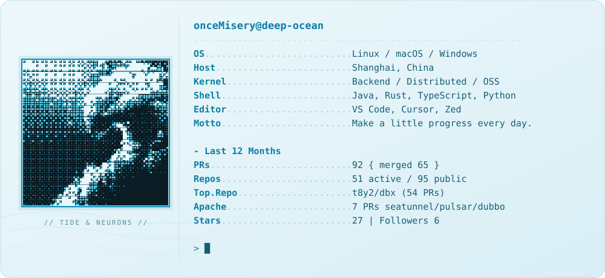

<a href="https://github.com/onceMisery">
  <picture>
    <source media="(prefers-color-scheme: dark)" srcset="https://raw.githubusercontent.com/onceMisery/onceMisery/main/dark_mode.svg">
    <source media="(prefers-color-scheme: light)" srcset="https://raw.githubusercontent.com/onceMisery/onceMisery/main/light_mode.svg">
    
  </picture>
</a>

<a href="https://github.com/onceMisery"><picture><source media="(prefers-color-scheme: dark)" srcset="https://raw.githubusercontent.com/onceMisery/onceMisery/main/link_github_dark.svg"></picture></a><a href="https://oncemisery.github.io/learning-hub"><picture><source media="(prefers-color-scheme: dark)" srcset="https://raw.githubusercontent.com/onceMisery/onceMisery/main/link_hub_dark.svg"></picture></a><a href="https://github.com/onceMisery/onceMisery/issues"><picture><source media="(prefers-color-scheme: dark)" srcset="https://raw.githubusercontent.com/onceMisery/onceMisery/main/link_issues_dark.svg"></picture></a>

  
  
  

> **Make a little progress every day.**

---

## 🧭 目录

| 章节 | 说明 |
| --- | --- |
| [关于我](#about) | 在做什么 |
| [过去一年](#year) | 提交与 PR |
| [活跃项目](#projects) | 仓库 |
| [贡献图](#snake) | 贡献图 |
| [联系方式](#contact) | 邮箱与链接 |

---

## 🌊 关于我

混迹在github的程序猿！
这一年大部分时间花在 [dbx](https://github.com/t8y2/dbx) 上。它是 Rust + Java + TypeScript 写的跨平台数据库客户端，我提了 54 个 PR，合并 50 个，做的是查询、连接恢复、ZooKeeper / Pulsar / Kafka 管理、CSV / XLSX 流式导出和插件。往 Apache SeaTunnel、Pulsar、Dubbo 也提过 PR 和 PIP。

自己在做 [seahorse-agent](https://github.com/onceMisery/seahorse-agent)，Java 写的，做 RAG 和长期记忆；[hertz-studio](https://github.com/onceMisery/hertz-studio) 是桌面客户端，最近在加桌面歌词和局域网一起听。

---

## 🗓️ 过去一年：2025.11 — 2026.11

下方数字是本页写作时的**快照（截至 2026-11-10）**，只统计公开数据；顶部卡片里的数值由工作流每日自动刷新。

| 指标 | 数值 | 统计口径 |
| --- | --- | --- |
| Pull Request | **92** 个（合并 **65**，进行中 3） | GitHub Search `author:onceMisery type:pr created:>=2025-11-10` |
| 活跃仓库 | **51** / 95 个公开仓库 | `pushed_at` 落在最近 365 天内 |
| dbx 生态 PR | **67** 个（含 t8y2/dbx 的 54 个、合并 50 个） | dbx / dbx-store / dbx-agents 及其个人 fork |
| Apache 上游 PR | **7** 个（SeaTunnel 4 · Pulsar 2 · Dubbo 1） | `org:apache` |
| 自有仓库 Star | **27**（最高 seahorse-agent，12 ★） | 仅统计非 fork 的 20 个自有仓库 |
| Issue / 讨论 | 10 个 | 含 dubbo#16108、dbx 的 bug 与 feature 反馈 |

> **为什么没有 commit 总数**：fork 会继承上游的提交历史，Search API 的 `author:` 会把这些提交重复计入本人名下，得到的数字没有意义。这里只列可复核的 PR、仓库与 Star。

---

## 🚢 活跃项目

| 项目 | 角色 | 技术 | 近一年在做什么 |
| --- | --- | --- | --- |
| [t8y2/dbx](https://github.com/t8y2/dbx) | 核心贡献者 | Rust / Java / TypeScript | 54 个 PR：查询、连接恢复、ZK / Pulsar / Kafka Agent、流式导出、插件与 MCP |
| [t8y2/dbx-store](https://github.com/t8y2/dbx-store) · [dbx-agents](https://github.com/t8y2/dbx-agents) | 贡献者 | Java / 插件元数据 | ZooKeeper Agent、hertz-studio 插件上架与版本发布 |
| [apache/seatunnel](https://github.com/apache/seatunnel) · [pulsar](https://github.com/apache/pulsar) · [dubbo](https://github.com/apache/dubbo) | 上游贡献者 | Java | Connector-V2 Pulsar 多表读取、CDC 修复、PIP-459、registry 去重 |
| [onceMisery/seahorse-agent](https://github.com/onceMisery/seahorse-agent) | 作者 | Java | 企业级 RAG / 长期记忆 / 可治理智能体，记忆引擎与 query optimizer（12 ★，本页最高） |
| [onceMisery/hertz-studio](https://github.com/onceMisery/hertz-studio) | 作者 | JavaScript / Rust / 桌面端 | AI 壁纸、桌面歌词舞台、局域网一起听、dbx 插件 |
| [onceMisery/Seahorse](https://github.com/onceMisery/Seahorse) · [rust-study](https://github.com/onceMisery/rust-study) · [NovaHub](https://github.com/onceMisery/NovaHub) | 作者 | Rust | Rust 学习与长期实验 |
| [onceMisery/learning-hub](https://github.com/onceMisery/learning-hub) · [harness-template](https://github.com/onceMisery/harness-template) · [smart-skills](https://github.com/onceMisery/smart-skills) | 作者 | HTML / Python | 知识沉淀、Agent 技能包与工程模板 |

还有 `DocForge`、`api-hub`、`cli-run-ui` 等几个小仓库，以及 75 个用来读源码的 fork。

---

## 🐍 贡献图动画

由 GitHub Actions 每日生成，并随 GitHub 明暗主题自动切换。

  <picture>
    <source media="(prefers-color-scheme: dark)" srcset="https://raw.githubusercontent.com/onceMisery/onceMisery/output/github-contribution-grid-snake-dark.svg">
    <source media="(prefers-color-scheme: light)" srcset="https://raw.githubusercontent.com/onceMisery/onceMisery/output/github-contribution-grid-snake.svg">
    
  </picture>

---

## 📬 联系方式

| 渠道 | 地址 |
| --- | --- |
| GitHub | [@onceMisery](https://github.com/onceMisery) |
| 邮箱 | [cmiracle@163.com](mailto:cmiracle@163.com) |
| Issues | [提问与建议](https://github.com/onceMisery/onceMisery/issues) |
| 学习驿站 | [learning-hub](https://oncemisery.github.io/learning-hub) |

欢迎就 Java、数据库客户端设计、消息中间件、一致性协议或 Apache 项目参与等话题交流。

---

**Make a little progress every day.**

